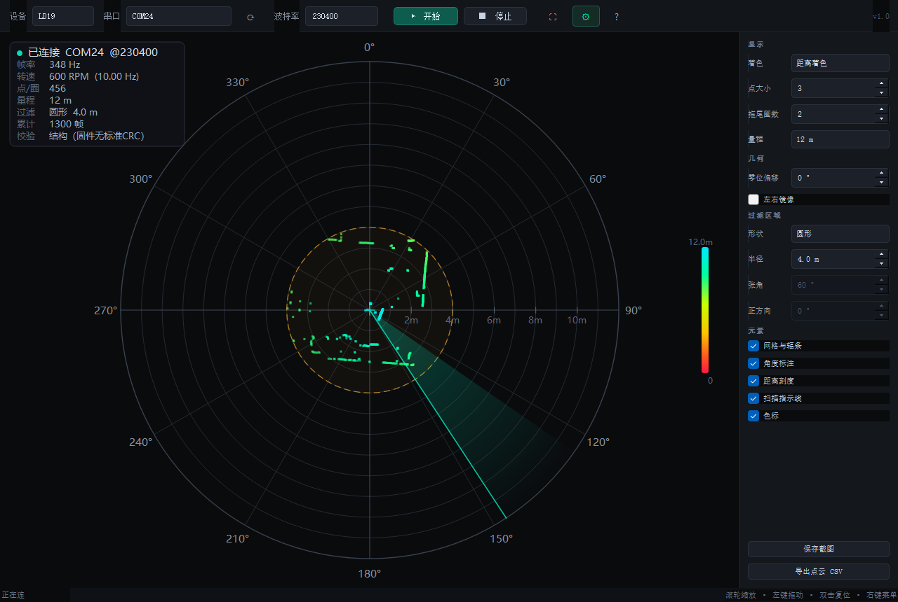

# LD19 激光雷达上位机（LD19 Viewer）

仿 **LDRobot LDS00 Tool (ld_desktop V2.3.12)** 的黑色极坐标雷达上位机，
数据源为乐动 LD19（DTOF）雷达的中国版串口协议。

- 源码：`ld19_viewer.py`（单文件，PyQt5）
- 可执行：`dist/LD19Viewer.exe`（免安装，双击即用）
- 环境：Python 3.8 + PyQt5 + pyserial
- 预览：`预览.png`



---

## 一、界面与功能

```
┌───────────────────────────────────────────────────────────────┐
│ 设备 LD19 │ 串口 COM24 ⟳ │ 波特率 230400 │ ▶开始 ■停止 ⛶ ⚙ ? │  v1.0
├──────────────────────────────────────────────┬────────────────┤
│ ● 已连接 COM24 @230400                        │ 显示           │
│   帧率  379 Hz  转速 600 RPM  点/圈 456       │  着色   距离   │
│                                               │  点大小  2     │
│            （黑底 12 环极坐标点云）            │  拖尾圈数 2    │
│                                               │  量程   自动   │
│                                               │ 几何 / 元素    │
├──────────────────────────────────────────────┴────────────────┤
│ 已连接 COM24 @230400 600 RPM 456 点/圈   滚轮缩放 · 左键拖动  │
└───────────────────────────────────────────────────────────────┘
```

| 功能 | 说明 |
|---|---|
| 串口枚举 / 波特率 | 自动列出 COM 口，`⟳` 刷新；LD19 出厂 230400 |
| 开始 / 停止 | 也可用 `Space` |
| 极坐标显示 | 12 道同心环（自动量程下每环 = 量程/12），每 30° 一条辐条并标注角度 |
| 角向约定 | **0° 在正上方，顺时针增大**，与官方 LDS00 Tool 一致 |
| 扫描指示线 | 青绿色扇形光束，跟随当前帧角度 |
| 着色 | 距离渐变色 / 强度渐变色 / 单色，右侧带色标 |
| 拖尾 | 1~6 圈余晖，旧圈按透明度衰减 |
| 量程 | **默认固定 12 m（刻度轴纹丝不动）**；手动可 4/8/12/16/20/25 m；「自动」为分档跳变 |
| 几何 | 角度零位偏移 ±180°、左右镜像 |
| **过滤区域** | 只显示区域内的点：**圆形（半径）/ 方形（边长）/ 扇形（半径+张角+正方向）**，圆形与方形还可整体偏移，边界画琥珀虚线 |
| 鼠标 | 滚轮以光标为中心缩放、左键拖动平移、双击复位 |
| 导出 | 保存截图 PNG、导出点云 CSV（angle,dist,intensity,x,y） |
| 状态 | HUD 显示帧率、转速、点/圈、累计帧数、校验模式 |
| 记忆 | 串口、波特率、配色、量程等参数退出后自动保存 |

### 关于距离轴的稳定性

量程决定了网格环间距和刻度位置，所以它**不能跟着点云连续变化**。

- 手动档（默认 12 m）：`rng` 恒定，环和刻度只随窗口大小 / 缩放变化，静止不动。
- 自动档：先按实测点云 98 分位算目标值，再**吸附到固定档位**
  `1.5 / 2 / 3 / 4 / 5 / 6 / 8 / 10 / 12 / 16 / 20 / 25 m`，
  并加双向迟滞（涨到 95% 才扩、缩到 50% 才收）+ 需稳定 **1.2 s** 才切档。
  也就是偶尔"跳"一档，绝不"呼吸"。

> v1.0 早期版本用连续平滑（每次 `+10%` 逼近目标），目标值每圈都在变，
> 结果整个网格像在呼吸。v1.1 起改为上面这套，并把默认值锁回 12 m。

### 关于显示区域过滤（ROI）

设置面板「过滤区域」里选形状，只显示区域内的点，虚线为区域边界：

| 形状 | 填什么 | 判定 |
|---|---|---|
| 圆形 | **半径** 0.5~15 m + 偏移X/Y | `(x-dx)² + (y-dy)² ≤ R²` |
| 方形 | **边长** 0.5~15 m + 偏移X/Y | `\|x-dx\| ≤ L/2 且 \|y-dy\| ≤ L/2` |
| 扇形 | **半径 + 张角 + 正方向** | `r ≤ R` 且 `\|θ − 正方向\| ≤ 张角/2` |

- **偏移X / 偏移Y**（±15 m）：把圆形、方形的中心从雷达挪到别处。
  X+ 向右、Y+ 向正前方；例如边长 4 m + 偏移(+2, +1.5)，
  方形就覆盖雷达前方偏右的一块区域。扇形不支持偏移（它本身就绕中心）。
- 正方向 0° = 雷达正前方（画布正上方），可转 ±180°；张角 10~360°
- 区域按**显示坐标**计算，所以跟着「零位偏移 / 左右镜像」一起转，看到什么就过滤什么
- 导出 CSV、保存截图都只含区域内数据；HUD 会显示当前过滤条件
- 「量程」选自动时，也按过滤后的点拟合，量程会跟着区域走

---

## 二、串口协议（实测结论）

**物理层**：COM24（CP210x）→ 230400 bps，8 数据位 / 无校验 / 1 停止位，雷达上电即连续输出，无需下发任何启动指令。

**帧格式：固定 47 字节**

| 偏移 | 长度 | 字段 | 说明 |
|---|---|---|---|
| 0..1 | 2 | 帧头 | 固定 `0x54 0x2C` |
| 2..3 | 2 | 转速 | uint16 LE，deg/s。实测 3581~3595 → 9.96 Hz ≈ 600 RPM |
| 4..5 | 2 | 起始角度 | uint16 LE，单位 0.01° |
| 6..41 | 36 | 12 个测距点 | 每点 3 字节：距离 uint16 LE（mm）+ 强度 uint8 |
| 42..43 | 2 | 结束角度 | uint16 LE，单位 0.01° |
| 44..45 | 2 | 时间戳 | uint16 LE，ms，约 65.5 s 回绕一次 |
| 46 | 1 | 校验字节 | 见下方说明 |

**每点角度插值**

```
span   = (end_angle - start_angle) mod 360      // 实测 8.3° ~ 9.9°，均值 8.72°
step   = span / 11
angle_i = (start_angle + step * i) mod 360      i = 0..11
x = d * sin(angle)      // 0° 朝上、顺时针
y = d * cos(angle)
```

**实测数据（静态 3 秒 / 1112 帧）**

| 指标 | 数值 |
|---|---|
| 帧率 | ≈ 372~392 Hz |
| 每圈帧数 | 38 帧 → **456 点/圈**（角分辨率 0.79°） |
| 帧间起始角步进 | 9.51°（= 帧内 8.72° + 1 个 0.79° 的步长，跨帧连续无空洞） |
| 回绕 | 360°→0° 正常，`ppr` 稳定 456 |
| 零距离点 | 约 3%（无回波，程序自动跳过） |

### ⚠ 关于第 47 字节（重点）

它 **不是** LD06 那套 `CRC8(poly=0x4D, init=0xD8)`：

- 对 522 帧用 `crc8(f[:46]) == f[46]` 检验，通过率 **1.3%**（等于随机命中）；
- 用 256 个多项式 × init{0x00,0xFF,0xD8} × 6 种区间 × 两种位序暴力枚举，
  **无任何组合**能全帧通过；用"解未知 init"的仿射反解同样无解。

结论：该固件的校验方式与公开 LD06/LD19 规范不同（或是私有查表）。
因此本程序采取 **结构校验**：

1. 帧头必须 `0x54 0x2C`；
2. 转速 ≤ 12000 deg/s；
3. 角度跨度 `(ea-sa) mod 360 ≤ 60°`；
4. 47 字节定长步进，失配时逐字节重同步。

并在启动 60 帧内**自动探测** CRC8 是否可用——可用（通过率 > 85%）就自动升级为 CRC 严格校验。
实测本机雷达进入"结构"模式，HUD 显示 `校验 结构（固件无标准CRC）`。

### 采样率 / 转速能不能改？

**结论：采样率改不了，转速能用 PWM 改，但和串口无关。**

1. **采样率固定**：LD19 测距单元 4500 次/秒，每帧固定 12 点
   （`VerLen` 字节高 3 位=包类型、低 5 位=点数，硬件写死 `0x2C`），
   帧长固定 47 字节，**无法通过任何指令改变**。

2. **串口是单向的**：4 芯接口为 `Tx / PWM / GND / 5V`，**根本没有 RX 脚**，
   雷达只发不收，所以不存在"发指令改配置"这回事（手册原文：不需要发送任何指令）。

3. **转速只能走 PWM 脚（第 2 脚）**：
   | 项目 | 要求 |
   |---|---|
   | PWM 频率 | 20~50 kHz，推荐 **30 kHz** |
   | 占空比 | **(45%, 55%)** 区间内（不含端点）才被识别为有效调速信号 |
   | 触发时间 | 至少持续 **100 ms** |
   | 恢复 | 进入外部控速后会一直保持，**必须断电重启**才回到内部 10 Hz |

   PWM 脚悬空/高阻或接地 = 内部控速，稳定 10 Hz。
   占空比与转速的具体曲线出厂未标定（各电机存在个体差异），
   所以要精确控速必须拿数据包里的转速字段做闭环。

4. **转速决定"细节"（角度分辨率）**，因为测量率是固定的：

   ```
   每圈点数 ≈ 4500 / 转速(Hz)        角分辨率 = 360 / 每圈点数
   ```

   | 转速 | 每圈点数 | 角分辨率 | 一圈耗时 |
   |---|---|---|---|
   | 5 Hz | ≈ 900 | **0.4°** | 200 ms |
   | 7.5 Hz | ≈ 600 | 0.6° | 133 ms |
   | **10 Hz（默认）** | **≈ 450（实测 456）** | **0.8°** | 100 ms |
   | 15 Hz | ≈ 300 | 1.2° | 67 ms |
   | 20 Hz | ≈ 225 | 1.6° | 50 ms |

   降速 = 更密的点、更慢的刷新；提速 = 更稀的点、更快的刷新。
   做建图可以降速换密度，做实时避障/控制环建议保持 10 Hz 以上。

5. **单帧内 12 点的角度插值也不能改**（固定 `step = span/11`），
   降速后每帧覆盖的角度 span 会相应变小，而不是一帧塞更多点。

> 本程序只能"读"转速（HUD 里的 RPM / 点/圈 就是读出来的），无法设置；
> 要调速请在硬件上把第 2 脚接到 MCU 的 PWM 输出（如 STM32 `TIM` 30 kHz），
> 再按收到的转速字段做闭环。


---

## 三、下位机（STM32H723）接收要点

放到 `2027Innovation_Car` 里正好用得上：

1. **波特率必须 230400**，USART 时钟误差 < 2%。
2. **用 DMA + IDLE 中断收**，不要逐字节中断：约 23 KB/s，每帧仅 2.5 ms。
3. **环形缓冲**建议 ≥ 2 KB（一次 IDLE 可能收到多帧）。解析时同样按
   `0x54 0x2C` 对齐 + 47 字节定长切片，**不要依赖第 47 字节做校验**，
   用上面的结构校验即可（转速/跨度）。
4. 一圈 = 38 帧 ≈ 456 点，`HAL_GetTick()` 或帧内时间戳可做丢帧判断。
5. 做建图/避障时建议在 MCU 侧先做**极坐标→直角坐标**换算再发上位机，
   或直接发原始 (angle,distance) 让上位机算，二选一别混。

---

## 四、常见问题

| 现象 | 处理 |
|---|---|
| 串口列表为空 | 装 CP210x 驱动（Silicon Labs），换 USB 口后点 `⟳` |
| 已连接但一直 0 帧 | 波特率不是 230400；或雷达 5V 供电不足 |
| 点云只有近处一团 | 距离轴不要选「自动」而选固定档；或物体反射弱（黑色/玻璃）导致无回波 |
| 画面全是放射状假点 | 串口误码，检查 USB 线与供电；换 460800 试 |
| 想逆时针显示 | 设置面板勾「左右镜像」 |

---

## 五、二次开发

```bash
# 运行源码
python ld19_viewer.py

# 自检（不开窗口交互，连 COM24 采 4 秒并存图）
python ld19_viewer.py --selftest COM24 4 out.png

# 重新打包 exe
build_exe.bat
```

代码结构（单文件，约 900 行）：

| 区块 | 作用 |
|---|---|
| `RadarState` | 串口线程写、界面线程读的共享状态（带锁），维护整圈点集 / 统计 |
| `RadarReader(QThread)` | 串口读取 + 47 字节帧解析 + 重同步 + CRC 自动探测 |
| `RadarView(QWidget)` | 纯 `QPainter` 极坐标绘制（网格/点云/扫描线/HUD/色标/光标读数） |
| `SettingsPanel(QFrame)` | 右侧显示参数面板 |
| `MainWindow` | 工具栏、状态栏、导出、快捷键、QSettings 记忆 |

绘图性能：点按颜色分 40 桶批量 `drawPoints`，1000 点 @30 fps 无压力。

---

*协议结论基于本机 LD19 实测（COM24 / 230400），仅供工程参考。*
